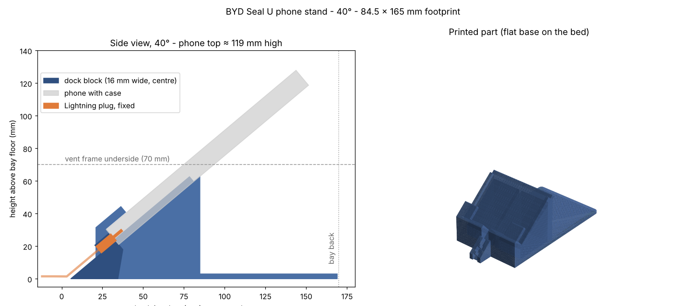
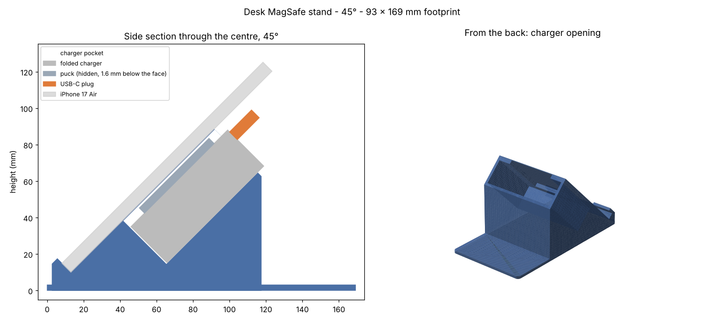

# מעמד טלפון ל-BYD Seal U DM-i / Seal U phone stand

מעמד שנכנס ל**תא הטעינה האלחוטית השמאלי** בקונסולה (הקרוב להגה) ומחזיק
טלפון אחד לאורך, נטוי לאחור, עם המסך כלפי הנהג. **בלי הדבקה ובלי תפס
למזגן** — הבסיס יושב בתא. מאז ההרחבה (89.5 מ"מ) הוא רחב מהמרווח בין
בליטות הגומי (85 מ"מ), אז הוא לא נכנס ביניהן אלא יושב רחב יותר.

A drop-in stand for the left wireless-charging bay of the BYD Seal U DM-i
centre console. Held by the bay's rubber tabs only: no adhesive, no vent clip.



## קבצים / Files

| קובץ | זווית מהרצפה | גובה המעמד | גובה קצה הטלפון | הערות |
|------|--------------|-------------|-------------------|-------|
| [fit_test_plate.stl](stl/fit_test_plate.stl) | — | 2 מ"מ | — | **להדפיס קודם** (~15 דק') ולבדוק שנכנס לתא |
| [dock_plug_fit_test.stl](stl/dock_plug_fit_test.stl) | — | 31.5 מ"מ | — | **להדפיס קודם** (~10 דק'): קטע התעלה עם המדרגה והתפס — לבדוק שהתקע יושב טוב והכבל ננעל בתפס |
| [seal_u_phone_stand_35deg.stl](stl/seal_u_phone_stand_35deg.stl) | 35° | 59 מ"מ | ~108 מ"מ | הכי שכוב; הטלפון מגיע ~1 ס"מ מהקיר האחורי |
| [seal_u_phone_stand_40deg.stl](stl/seal_u_phone_stand_40deg.stl) | 40° | 63 מ"מ | ~119 מ"מ | **ברירת מחדל** |
| [seal_u_phone_stand_45deg.stl](stl/seal_u_phone_stand_45deg.stl) | 45° | 67 מ"מ | ~128 מ"מ | הכי זקוף |

לכל קובץ STL יש גם **קובץ 3MF** באותו שם (למשל
[seal_u_phone_stand_45deg.3mf](stl/seal_u_phone_stand_45deg.3mf)). ב-Bambu Studio עדיף
לייבא את ה-3MF: הוא שומר את הרשת סגורה בדיוק כמו שנבנתה, בלי שהסלייסר יצטרך
לחבר מחדש משולשים.

תצוגות: [35°](stl/seal_u_phone_stand_35deg_preview.png) ·
[40°](stl/seal_u_phone_stand_40deg_preview.png) ·
[45°](stl/seal_u_phone_stand_45deg_preview.png)

## מידות / Dimensions

- **בסיס:** 89.5 מ"מ רוחב (הורחב ב-5 מ"מ, `WIDEN`), מתחיל בקדמת המדף (בלי
  לשוניות קדימה) ונגמר 169 מ"מ מקדמת התא; בלוק העגינה באמצע בולט קדימה —
  סה"כ ~163 מ"מ אורך.
- **עריסה:** 84.5 מ"מ בין הדפנות (דפנות צד של 2.5 מ"מ), מרווח 22.5 מ"מ לעובי
  (10 מ"מ יותר מהטלפון העבה). סמסונג עם כיסוי (82 × 7 מ"מ) נכנס עם 1.25 מ"מ
  לכל צד, ואייפון 14 פרו עם כיסוי (~78 × 11 מ"מ) עם ~3 מ"מ לכל צד. העגינה
  בנויה לתקע לייטנינג — לטלפון עם USB-C צריך לשנות את `DOCK_*`.
- **תמיכה:** משטח גב באורך 65 מ"מ (5 מ"מ מעבר לדפנות הצד), כך שכל המעמד
  נשאר מתחת למסגרת המזגן (70 מ"מ) — נבדק בכל יצירה; דפנות צד נמוכות (4 מ"מ) רק ב-60 המ"מ
  התחתונים, כדי לא ללחוץ על כפתורי הצד. שפה קדמית רק בפינות (16 מ"מ גובה, 4.5 מ"מ עובי) — תחתית המסך פנויה.
- **עגינה (Lightning, אייפון 14 פרו עם כיסוי):** תקע הכבל יושב **קבוע** בתעלה
  במדף, הקצה כלפי מעלה לאורך ציר הטלפון. מורידים את הטלפון בין הדפנות —
  הוא מתחבר לבד; מרימים — התקע נשאר במקום.
  - **תעלה פתוחה לכל האורך:** מהמדף ועד היציאה בחזית המעמד אין שום חור —
    התעלה פתוחה קדימה (לכיוון המסך), כך שמניחים את התקע והכבל פנימה מלפנים,
    בלי להשחיל. הכבל יוצא נמוך מחזית המעמד אל רצפת התא.
  - **מבנה התעלה (מלמעלה למטה):** 10.5 מ"מ לראש התקע → מדרגה שהתקע נעצר
    עליה → 5 מ"מ לאורך 8 מ"מ ל-strain relief → **תפס טריז** לאורך 10.5 מ"מ:
    חריץ V פתוח קדימה, 1.6 מ"מ בתחתית ומתרחב ב-0.5 מ"מ לכל מ"מ גובה, עם
    צלעות שמצרות אותו ב-0.6 מ"מ כל 1.5 מ"מ. לוחצים את הכבל באגודל לתוך
    ה-V עד שהוא נתקע — השיפוע תלול מספיק כדי שהחיכוך ינעל אותו, והצלעות
    תופסות לאורך הכבל, כך שהתקע לא נשלף כשמרימים את הטלפון. מתאים לכל כבל
    של 3–5 מ"מ (כבל דק נכנס עמוק יותר, עבה נתקע גבוה יותר).
  - **מיקום התקע:** התעלה פתוחה כלפי מעלה-קדימה, אז ראש התקע שוכב על רצפת
    התעלה בכוח הכובד, והטלפון נשען על משטח הגב באותו אופן. רצפת התעלה
    ממוקמת כך שמרכז התקע יהיה `DOCK_PORT_N = 5.5` מ"מ מגב הכיסוי (3.9 חצי
    עובי הטלפון + ~1.6 גב הכיסוי). לצדדים ראש התקע "צף" בתעלה ומתיישר עם
    השקע כשהטלפון יורד.
  - **ראש התקע:** כל ראש עד 10 מ"מ רוחב. העובי קובע את מיקום הקצה, ולכן
    `DOCK_BOOT` מוגדר ל-8 × 5.3 × 12 מ"מ (כבל Apple מקורי). לראש בעובי אחר
    צריך לעדכן את העובי. הראש בולט 0.5 מ"מ מעל המדף לתוך פתח הכיסוי,
    והקצה המתכתי (6.7 מ"מ) נכנס ~5.7 מ"מ לטלפון עם תחתית כיסוי של 1.5 מ"מ.
  - **כבל אחר / כיסוי אחר:** למדוד ולשנות `DOCK_BOOT`, `DOCK_PORT_N`, `DOCK_SLOT_W`
    (ואם תחתית הכיסוי עבה — `DOCK_RISE`). פתח הכיסוי צריך להיות גדול מראש התקע.
  - **בדוק בקוד** (`check_dock`, רץ בכל יצירה): הטלפון, ראש התקע (בכל מיקום
    בתעלה), הקצה וה-strain relief לא נוגעים במעמד; לתקע יש מדרגה לשבת עליה;
    התעלה פתוחה קדימה לכל האורך; כבל של 3–5 מ"מ ננעל בתפס, בתוך הבלוק;
    הדפנות לפחות 1.5 מ"מ.
  - בזווית הזאת הטעינה האלחוטית של התא לא מגיעה לטלפון.
- **שימו לב:** קצה הטלפון העליון עומד מול הלמלות התחתונות של פתח המזגן
  השמאלי (המסגרת הכסופה מתחילה בגובה 70 מ"מ מהרצפה).

## הדפסה ב-Bambu Lab P2S

1. **קודם פלטת הבדיקה.** אם היא צמודה מדי/רופפת — לשנות `FIT` בסקריפט
   (0.25 מ"מ לכל צד) ולהריץ מחדש.
2. **כיוון:** כפי שהקובץ נטען — הבסיס השטוח על המשטח. **בלי תמיכות**
   (כל השיפועים 35°–55°; התעלה פתוחה, אין בה גשרים).
3. **חומר:** **PETG או ASA** — לא PLA (מתעוות באוטו חם בקיץ).
4. **מילוי:** 15–20%, 3 קירות, שכבה 0.2 מ"מ. בערך 80–100 גרם.

## שינוי מידות / Changing dimensions

כל המידות הן קבועים בראש [`generate_holder.py`](generate_holder.py)
(`P0`, `SUPPORT_L`, `PHONE_T`, `DOCK_*`, `VARIANTS` וכו').

```bash
pip install -r phone-holder/requirements.txt
python3 phone-holder/generate_holder.py        # כל הגרסאות
python3 phone-holder/generate_holder.py 40     # רק 40°
```

---

# מעמד שולחני עם מטען MagSafe מוסתר / Desk MagSafe stand

גרסה למשרד בבית: אותו מעמד ב-**45°**, עם המטען המתקפל 3-ב-1 (מקופל) **בתוך**
המעמד. הטבעת המגנטית מכוסה ב**שכבת פלסטיק רציפה של 0.6 מ"מ** — מבחוץ רואים
משטח חלק, והאייפון נצמד וטוען דרכו.



| קובץ | הערות |
|------|-------|
| [desk_pocket_fit_test.stl](stl/desk_pocket_fit_test.stl) | **להדפיס קודם** (~15 דק'): מסגרת בחתך של הכיס — המטען צריך להחליק דרכה בחופשיות |
| [desk_magsafe_stand_45deg.stl](stl/desk_magsafe_stand_45deg.stl) | המעמד, 93 × 169 מ"מ, גובה 88.5 מ"מ |

- **הכנסה / הוצאה:** המטען מקופל, הטבעת כלפי הטלפון ושקע ה-USB‑C כלפי מעלה,
  מחליק פנימה דרך הפתח בקצה העליון-אחורי של המשטח עד העצירה. הוא בולט 5 מ"מ
  מהפתח — תופסים שם ומושכים.
- **כבל:** יוצא מהפתח מאחור (תקע 17 × 11 × 6 מ"מ נבדק) ויורד לשולחן.
- **מיקום:** הצלע התחתונה של המטען 41 מ"מ מעל המדף, מרכז הטבעת 78.5 מ"מ —
  כמו שנמדד על האייפון 17 אייר (156 מ"מ, 41 מ"מ מלמטה ומלמעלה).
- **מרחק טבעת–טלפון:** 1.6 מ"מ (0.6 שכבה + 1.0 מרווח; כוח הכובד מושך את
  המטען לדופן האחורית של הכיס).
- **כיס:** 87 × 75 מ"מ, עובי 33 מ"מ (מטען 86 × 75 × 32 כולל הטבעת), ערוץ
  ברוחב 57 מ"מ ובגובה 3 מ"מ לטבעת (1.5 מ"מ מרווח לכל צד) לכל אורך המסלול.
- **בדיקה בקוד** (`check_fit`): המטען עם התקע לא נוגע במעמד במקומו, **ונשלף
  החוצה לכל אורכו בלי להיתקע**; הטלפון לא נוגע במעמד.

**הדפסה:** הבסיס על המשטח, בלי תמיכות (תקרת הכיס ב-45°). PETG/PLA (בבית PLA
מספיק), 3 קירות, מילוי 15%, שכבה 0.2 מ"מ. את השכבה הדקה לא ללטש.

```bash
python3 phone-holder/generate_desk_stand.py
```
